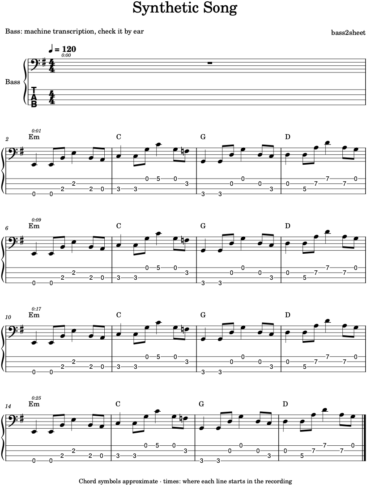

# bass2sheet

Turn a song into a bass part you can read and play. One command takes an audio file and writes a printable PDF with bass clef and tab, plus MusicXML, MIDI, listening files and a quality report that says how far to trust the result and which bars to check by ear.

```
bass2sheet "Artist - Title.mp3"
```



The transcription is done by machine and is not perfect. That is why every run measures itself: twelve quality gates decide a PASS, WARN or FAIL verdict, and the bars where independent checks disagree are marked in the PDF. See [Accuracy](#accuracy) for measured results on public datasets.

Feed it audio you have the rights to use. bass2sheet downloads nothing from video or streaming sites.

## Install

Python 3.12 and [uv](https://docs.astral.sh/uv/) are required. macOS on Apple Silicon is the tested platform; Linux should work and is covered by CI for the tests that need no models.

```
git clone <this repository> && cd bass2sheet
uv sync --python 3.12
uv run bass2sheet --help
```

Two optional pieces:

- **MuseScore 4**, for the PDF: `brew install --cask musescore` on macOS, or any install that puts `mscore` on the `PATH`. Without it you still get MusicXML, which opens in any notation program.
- **Basic Pitch**, for the second-opinion gates. It needs its own environment, because its ONNX/TensorFlow stack does not share one with PyTorch well:

  ```
  uv venv --python 3.12 .venv-bp
  uv pip install --python .venv-bp/bin/python basic-pitch onnxruntime 'setuptools<81'
  ```

  bass2sheet finds `.venv-bp` in the checkout, or set `BASS2SHEET_BASIC_PITCH_PYTHON` to another interpreter.

The first run downloads the separation models (about 1 GB) into `~/.cache/bass2sheet`. The same cache holds stems and pitch tracks, so re-running a song takes seconds.

## Use

```
bass2sheet SONG [-o OUT_DIR] [--title T] [--artist A] [--strict]
```

`SONG` is any audio or video file ffmpeg can read. Title and artist default to the file name (`Artist - Title.ext`). The output directory defaults to `<song name> bass` beside the song:

| File | What it is |
|---|---|
| `bass.pdf` | The printable score: bass clef (written an octave up, as bass parts are) over 4-string tab, chord symbols, the recording time at the start of each line, uncertain notes in parentheses, a red "check" over bars to verify |
| `bass.musicxml` | The same score, editable in MuseScore or any notation program |
| `bass.mid`, `bass_as_played.mid` | MIDI on a steady grid, and MIDI aligned with the recording |
| `notes.json` | Every note with its time, pitch, bar position and flags; key, tempo, chords |
| `report.html`, `report.json` | The verdict, each gate's value and threshold, the bars to check and why |
| `audio/` | The separated bass, the transcription synthesized, the transcription played with the bass's own sound (`bass_rebuilt.wav`: each note by a sample cut from another note), the song with the transcription in place of the real bass, and real bass left / transcription right for headphones |

Exit codes: `0` the sheet was written (PASS or WARN); `2` the result failed its gates (the sheet is marked DRAFT, or not written with `--strict`); `1` error (unreadable input, no bass found).

Other options: `--separator auto|roformer|demucs`, `--stems DIR` (use stems you already have and skip separation), `--beat-tracker auto|beat_this|librosa`, `--replucks every|clear`, `--together write|single`, `--lowest NOTE`, `--rhythm literal|simple`, `--tab low|position`, `--no-audio`, `--no-pdf`, `--second-opinion off`, `--mscore PATH`, `--cache-dir DIR`, `--device mps|cuda|cpu`, `--crepe-model full|tiny`.

A 4-minute song takes about 3 minutes on an M-series MacBook the first time.

## Judge it on your own songs

Accuracy numbers cannot tell whether the sheet suits you. `bass2sheet-judge` can. It takes your songs through the pipeline one step at a time and, at each step, shows you short passages where the tool's choice and its alternative differ. You hear and see that step's own output and pick, without being told which is which.

```
bass2sheet-judge build SONG... --dir judging
bass2sheet-judge serve --dir judging        # then open http://localhost:8765
```

`bass2sheet-judge check --dir judging` needs no listening: it compares every note with the sound of the song's other notes of its pitch and reports the share that do not match, per song, and how that share moved since the tool last changed.

The steps are: which model isolates the bass (you hear the two isolated tracks), which notes are found in it, whether two notes played together are written as a chord, where the bar lines fall, whether the rhythm is written as played or simplified, and whether the tab stays low on the neck or in one position. Each step of a song is built on what you picked before it. Your picks decide the defaults, and every passage you judged comes back if a later change alters it. See [docs/judging.md](docs/judging.md).

## Make the score yours

The machine's sheet is a first draft. `bass2sheet-copilot` puts you in charge of the final one and makes the machine your copilot.

```
bass2sheet-copilot add SONG... --dir scores
bass2sheet-copilot serve --dir scores        # then open http://localhost:8770
```

The song plays through on a timeline: the isolated bass as a picture of pitch against time, the notes the tool heard drawn over it and played in the bass's own sound against the record. You stop where a note is wrong and fix it. For another pitch the tool offers its guesses, best first, and one key takes one; you can also nudge a note, delete it, add one, split one in two or join two. The tool finds the bars that sound alike and names them over the timeline: after a fix it offers the same fix for the repeats that have the same mistake, and it marks where a bar is written unlike a repeat that sounds the same. You decide. What you leave as it is, as far as you have worked, counts as right. The sheet is written from your notes.

Every fix is the tool's record of a mistake, with the right answer attached: `bass2sheet-copilot report` lists them by kind. See [docs/copilot.md](docs/copilot.md).

## Another note finder: MuScriptor

`--notes muscriptor` writes the notes of [MuScriptor](https://github.com/muscriptor/muscriptor), Kyutai and Mirelo's transcription model, in place of bass2sheet's own, which become the second opinion that says which notes to doubt. On the bass bass2sheet isolates, MuScriptor is the better note finder (0.83 against 0.76 on RWC Popular, 0.91 against 0.79 on a bass played alone). It is optional, runs through a program you build separately, and its weights are for non-commercial use under conditions of their authors. See [docs/muscriptor.md](docs/muscriptor.md).

## How it works

1. **Decode and validate.** Any format to 44.1 kHz stereo. Unreadable, silent, very short or very long input is refused with a message.
2. **Separate the bass.** BS-RoFormer SW (via [audio-separator](https://github.com/nomadkaraoke/python-audio-separator)) is the default. Demucs `htdemucs_ft` is tried when it fails or its result fails the gates; of the two results, the one with fewer failed gates is kept, then the one whose note starts Basic Pitch confirms more often.
3. **Track pitch.** CREPE on the GPU, with pYIN as a cross-check. CREPE's output is decoded into a pitch path that moves smoothly within a note and may leap between notes, as a bass line does.
4. **Find the notes.** Hysteresis on pitch confidence, so a note survives the brief loss of pitch at each pluck; a held note is split where the string is plucked again, and only there; notes hold until the next one; each start moves to where its pluck begins to sound, at 1 ms resolution; notes whose spectrum contradicts their octave are corrected. What the pitch tracker reports between notes is not written: the slide from one note to the next, the pitch sinking as a note is let go, the thump of a pluck. The pitch trackers follow one note at a time, so every stretch is then looked at again for two notes played together: the spectrum's peaks must hold a second note of their own that starts with the first, lasts with it and is louder in the bass track than in the rest of the record. An octave is never written as two notes.
5. **Find the grid.** Beats and downbeats come from the [Beat This!](https://github.com/CPJKU/beat_this) model on the full mix. A built-in tracker (beats from drums and bass, the downbeat where the harmony changes) is the fallback. Notes are quantized to sixteenths in 4/4.
6. **Key and chords.** Rough estimates for the chord symbols and note spelling.
7. **Engrave.** MusicXML with a tab staff whose fingering comes from a search that keeps the fretting hand in place; MuseScore turns it into the PDF.
8. **Check the notes by the bass's own sound.** Every note found is also a sample of what this bass sounds like at that pitch on this recording. Each note is compared with the other notes written with its pitch. One they do not explain, or that another pitch's notes explain better, is probably wrong: it goes in parentheses and on the list of bars to check.
9. **Judge the result.** The quality gates below.

## Quality gates

There is no reference transcription for your song, so each gate is an independent proxy. None is trusted alone.

| Gate | Passes at | Fails beyond | What it catches |
|---|---|---|---|
| Bass stem level vs the mix | ≥ −25 dB | −35 dB | The separator found no bass |
| Sounding bass covered by notes | ≥ 97% | 85% | Missing notes |
| Notes cut short while the bass rings | ≤ 4% | 12% | Choppy note ends |
| Same note name as the recording | ≥ 90% | 78% | Wrong notes, judged on the rendered transcription |
| Notes with a doubtful octave | ≤ 1% | 5% | Octave errors |
| Notes unlike the song's other notes of their pitch | ≤ 15% | reported only | A wrong note among right ones. Not part of the verdict yet |
| Same pitch as Basic Pitch | ≥ 90% | 70% | Disagreement with an independent model |
| Note starts shared with Basic Pitch | F ≥ 0.75 | 0.50 | Missed, extra or mistimed notes |
| Note starts' distance from the 16th grid | ≤ 32 ms | 50 ms | A wrong tempo or grid, or swing |
| Downbeats that fit 4/4 | ≥ 80% | warns only | 3/4, 6/8 or a changing meter, which the 4/4 score cannot show; bar lines may be shifted |
| Notes on 8th-note positions | ≥ 60% | warns only | A shifted grid or swing (or simply a busy sixteenth-note line) |
| Notes flagged uncertain | ≤ 6% | 20% | The two pitch trackers disagree |
| Bars that need an ear check | ≤ 6% | 25% | Too many bars where the checks disagree |

FAIL if any gate fails, or if five or more of the accuracy gates warn at once; WARN if any gate warns; otherwise PASS. Each bar also gets a severity that adds up independent signals (missing notes, a pitch mismatch with the recording, Basic Pitch disagreeing, a doubtful octave, a note that does not sound like its namesakes); the report lists the bars worst first, and severity 3 or more puts the red "check" in the PDF.

The thresholds come from evaluation runs with ground truth: a gate warns below what 90% of the accurate runs reach, and fails where only inaccurate runs were seen. `bass2sheet-eval` reports, for each gate, how well it tracks the measured score.

## Accuracy

Version 0.2.0, measured with `bass2sheet-eval`. The full mix goes in, with the same settings for every song.

| Dataset | Songs | Measure | Mean | Median |
|---|---|---|---|---|
| BabySlakh: synthetic songs, exact notes | 16 | Notes right: start within 50 ms, exact pitch (F-measure) | 0.91 | 0.96 |
| | 16 | The same, given the dataset's clean bass track | 0.94 | 0.95 |
| | 11 | Correct notes written on the right sixteenth of the bar | 0.66 | 0.77 |
| MDB-bass-synth: real multitrack songs, exact pitch curve | 24 of 71 | Share of the time the bass plays that has the right note | 0.77 | 0.80 |
| RWC Popular: studio pop, bass transcribed by ear | 24 of 100 | Notes right, start within 100 ms (F-measure) | 0.77 | 0.73 |
| | | Notes right, start within 50 ms | 0.71 | 0.67 |
| IDMT-SMT-Bass-Single-Track: a real bass guitar played alone, exact notes | 17 lines | Notes right: start within 50 ms, exact pitch (F-measure); no separation involved | 0.79 | 0.80 |

What that means in practice:

- **Clean material mostly comes out right.** 12 of the 16 BabySlakh songs score 0.90 or more and all but one score above 0.84. The one is a song where a synth plays an octave below the bass guitar: the separated bass track holds both, and over a third of the notes are written an octave low (0.49, against 0.89 from the dataset's clean bass track).
- **A real bass guitar is harder than a sampled one.** Played alone, with nothing to separate, 89% of the notes are found, but 13% of what the tool writes are re-attacks that were not played, and slap pops are found 66% of the time. Lines that jump a fifth or more upward are written right 78% of the time.
- **Real recordings are harder.** On RWC about a third of the notes differ from the reference: repeated notes written as one long note (12% of the reference's notes), re-attacks the reference does not have (9% of ours) and wrong pitches (6%). The reference was transcribed by ear, so part of the difference is its own.
- **Pitch is more reliable than rhythmic detail.** Octave errors are 1–3% of the notes.
- **Tempo is right on nearly every song; bar lines are not.** On BabySlakh, 5 of 11 songs have their notes on the right sixteenth of the bar throughout. On the others the bar lines are off for part or all of the song: finding the downbeat is the hard part, and the fixed 4/4 grid cannot follow a song whose bars change length. RWC scores 1.00 here, but the beat tracker was trained on RWC, so that number says little.
- **The verdict tracks accuracy.** Over the 80 runs, PASS results averaged 0.96 with none below 0.90, WARN 0.85 and FAIL 0.66. The thresholds were set on these same runs, so expect a looser relation on new songs.

How to reproduce these numbers, and what each dataset can and cannot tell you, is in [docs/evaluation.md](docs/evaluation.md).

## Limits

- The score is always written in 4/4 with straight sixteenths. Other meters and swing are not notated; the meter and grid gates flag them. Tempo changes are followed beat by beat, but the score shows one tempo.
- One bass. Two notes played together are written as a chord when the tool is sure of both; it misses about a quarter of them, and an octave is always written as its lower note. Three notes or more, and two basses at once, are out of scope.
- The tab assumes a 4-string bass in standard tuning, and so do the notes: what is heard below E1 (an octave effect, a synth under the bass) is written an octave up. `--lowest B0` is a five-string, `--lowest D1` drop-D, `--lowest none` writes the notes as heard.
- Very short staccato notes (under about 100 ms) are often missed, and fast repeated notes on one pitch can come out as one long note.
- A bar of another length (a 2/4 bar in a 4/4 song) shifts the bar lines after it.
- Chord symbols are rough. Slides, ghost notes and dead notes are not notated.

## Development

```
uv run pytest                 # the default tests: about 5 minutes, nothing needed beyond `uv sync`
uv run pytest --cov           # the same, with what they reach of the code: about 97% of lines and branches
uv run pytest -m browser      # every page in a real browser (uv sync --group browser; uv run playwright install chromium)
BASS2SHEET_FULL_E2E=1 uv run pytest -m full    # the real models: about 1 GB to download the first time
```

The default tests run the unit tests and the whole pipeline, the copilot and its pages' servers on a synthesized song, with no model download, no network and no browser: where a model or MuseScore would run, a stand-in does. CI runs them on every push to `main` and on every pull request, on Linux and macOS, and fails if they reach less than 95% of the code. [CONTRIBUTING.md](CONTRIBUTING.md) covers the tiers, what each needs and how long it takes, the evaluation workflow and the rule for changing transcription behaviour: measure it against ground truth first.

## Credits and licenses

bass2sheet is MIT licensed (see [LICENSE](LICENSE)). It stands on other people's work, each under its own license:

- Separation: BS-RoFormer (the SW checkpoint by jarredou, run through audio-separator) and [Demucs](https://github.com/adefossez/demucs)
- Pitch: [CREPE](https://github.com/marl/crepe) through [torchcrepe](https://github.com/maxrmorrison/torchcrepe), and pYIN in [librosa](https://librosa.org)
- Beats: [Beat This!](https://github.com/CPJKU/beat_this)
- Second opinion: [Basic Pitch](https://github.com/spotify/basic-pitch)
- Optional note finder: [MuScriptor](https://github.com/muscriptor/muscriptor) through [muscriptor.cpp](https://github.com/DamRsn/muscriptor.cpp) (weights CC BY-NC 4.0 with conditions of use; not downloaded by bass2sheet)
- Evaluation: [mir_eval](https://github.com/mir-evaluation/mir_eval), [pretty_midi](https://github.com/craffel/pretty-midi)
- Engraving: [MuseScore](https://musescore.org)

Model weights are downloaded at run time and are not part of this repository; check each model's terms before commercial use. The evaluation datasets have their own licenses, listed in [docs/evaluation.md](docs/evaluation.md).
